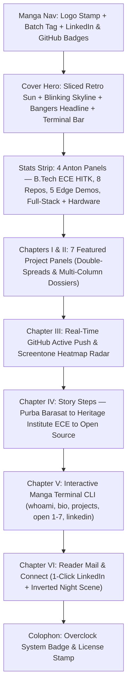

# SAYAN DEB // OVERCLOCK MANGA EDITION PORTFOLIO (ISSUE #01)


The official personal portfolio of **Sayan Deb** — B.Tech Electronics & Communication Engineering (ECE) student at **Heritage Institute of Technology, Kolkata (2025–2029)**.

Engineered with the **Overclock (overclock@1.0.0)** manga comic design system: hand-drawn panel outlines via SVG turbulence wobble filters (`#oc-sketchy`), halftone screentones, hard unblurred ink offset shadows, Bangers lettering over Anton numerals, an animated sliced retro sun, seeded skyline, and a live GitHub contribution radar.

---

## ⚡ Live Deployments & Profiles

- **Live Portfolio**: [https://debsayan.vercel.app](https://debsayan.vercel.app)
- **LinkedIn Profile**: [linkedin.com/in/hellosayandeb](https://www.linkedin.com/in/hellosayandeb)
- **GitHub Profile**: [@helloSayanDeb](https://github.com/helloSayanDeb)
- **Contact Email**: [sayandeb2006@gmail.com](mailto:sayandeb2006@gmail.com)

---

## 📖 Comic Issue Structure



---

## ✨ Features & Highlights

### 1. Overclock Manga Design System (`overclock@1.0.0`)
- **Hand-Drawn Wobble Ink Outlines**: Dynamic SVG displacement filters (`url(#oc-sketchy)` and `#oc-sketchy-sm`) creating authentic inked comic panel borders.
- **Manga Halftone Screentone & Speed Hatching**: Dot matrices (`--oc-dot`) and hard ink offset drop shadows (`--oc-shadow-frame`, `--oc-shadow-btn`).
- **Typography Matrix**:
  - **Bangers**: Bold comic lettering with ink text stroke and `-2deg` tilt.
  - **Anton**: Impactful numerals and chapter metrics (`01/07`).
  - **Barlow Condensed**: Ultra-readable editorial comic body copy.
  - **JetBrains Mono**: Terminal prompts, telemetry readouts, and code blocks.
- **Animated Retro Sun & Seeded Skyline**: Animated retro sliced sun with descending slice gaps and a seeded procedural city skyline with randomized blinking windows.

### 2. Showcase of 7 Verified Software & Hardware Projects
Each project card features domain-specific comic artwork, direct live application links, GitHub source repositories, and deep-dive dossier modals:
1. **Lemmata LaTeX Editor** (`latex-editor`): Flagship local-first LaTeX workstation with sub-second CircuiTikZ/Math compilation, vector PDF viewer, and local/cloud AI assistant. ([Live App ↗](https://latex-editor-umber.vercel.app))
2. **NISL Official Web Portal** (`nisl-portal`): Academic institution portal with drafting linework aesthetic, notice gazette, bilingual typography, and faculty councils. ([Live App ↗](https://nisl.vercel.app))
3. **NIARS Research Institute** (`academic-institute-website`): Academic research institute web platform with Cloudflare Pages SSG, Sanity CMS, defense-in-depth sanitization, and security headers. ([Live App ↗](https://niars.vercel.app))
4. **IoT Schematic Canvas & Firmware Validator** (`custom-eda-iot`): In-browser EDA schematic editor & CircuitPython validator with real-time DRC conflict detection. ([Live App ↗](https://custom-eda-iot.vercel.app))
5. **Gesture Bulb** (`gesture-bulb`): Cyberpunk lighting with 21-point MediaPipe hand skeleton tracking and synthesized mechanical audio feedback. ([Live App ↗](https://gesture-bulb.vercel.app))
6. **BIPSS** (`BIPSS`): Privacy-preserving Android companion fusing wearable BLE vitals with environmental sensor data (AQI/weather) for on-device explainable risk scoring.
7. **Mutual Fund Diversification Simulator** (`Mutual-Fund-Diversification-Simulator`): Quantitative asset allocation simulator with Monte Carlo 10,000 paths alpha distribution. ([Live App ↗](https://mutual-fund-diversification-simulat.vercel.app))

### 3. Manga-Styled GitHub Active Push & Contribution Radar
- **Screentone Contribution Heatmap**: 24-week calendar matrix starting on Sunday (Row 0) shaded from light paper dots to deep solid `#111111` ink blocks.
- **Interactive Speech Bubble Tooltips**: Hover and keyboard focus announce exact commit count and date formatted in comic style.
- **Live Active Push Dialogue**: Comic speech balloon with sound effect (`ピピピッ！`) showing real-time commit pushes resolved from the GitHub API.
- **Fallback Resilience**: Displays verified 71 contributions even under unauthenticated API rate limits.

### 4. Interactive Manga Terminal CLI
- Emulated terminal with macOS-style window dots and JetBrains Mono console.
- Up/Down arrow history buffer navigation + 10 quick-tap touch shortcut chips.
- Commands: `help`, `whoami`, `bio`, `education`, `skills`, `projects`, `open <1-7>` (launches live app in new tab), `dossier <1-7>`, `github`, `linkedin`, `contact`, `clear`.
- Isolated internal box scroll preventing unwanted page viewport jumps.

### 5. Reader Mail & Inverted Night Horizon
- Inverted night scene with animated retro sun and perspective floor lines.
- Direct 1-click **LinkedIn Profile Badge (`in/hellosayandeb`)**.
- Direct email launcher (`sayandeb2006@gmail.com`).
- Next.js Server Action (`submitContactAction`) with client validation and toast confirmation.

### 6. Custom SVG Favicon
- Custom scalable vector logo in `public/favicon.svg` featuring Sayan Deb's **"SD" monogram** in Bangers comic lettering, hard drop shadow, halftone ground, and mini sliced sun emblem.

---

## 🛠️ Tech Stack

- **Framework**: [Next.js 16 (App Router)](https://nextjs.org/)
- **Core Library**: [React 19](https://react.dev/)
- **Language**: [TypeScript 5](https://www.typescriptlang.org/)
- **Design System**: Overclock (`overclock@1.0.0`) by InstaLanding
- **Styling**: Vanilla CSS Design Tokens, SVG Filters, Halftone Screentone Gradients, Keyframe Animations
- **Typography**: `Bangers`, `Anton`, `Barlow Condensed`, `JetBrains Mono` via `next/font/google`
- **Icons**: [Lucide React](https://lucide.dev/) & Custom Manga SVG Icons

---

## 📁 Repository Structure

```text
├── public/
│   └── favicon.svg                    # Custom Overclock manga SD monogram favicon
├── src/
│   ├── app/
│   │   ├── @modal/
│   │   │   ├── (.)project/[id]/
│   │   │   │   ├── modal-client.tsx   # Modal client wrapper with router.back()
│   │   │   │   └── page.tsx           # Parallel intercepting SSG route component
│   │   │   └── default.tsx            # Null slot fallback
│   │   ├── actions/
│   │   │   └── contact.ts             # Contact form Next.js Server Action
│   │   ├── project/[id]/
│   │   │   └── page.tsx               # Standalone SSG project dossier page
│   │   ├── globals.css                # Overclock manga tokens & system stylesheet
│   │   ├── layout.tsx                 # Root layout with fonts, metadata, & SVG #oc-defs
│   │   └── page.tsx                   # Main Overclock Issue #01 comic page
│   ├── components/
│   │   ├── OverclockNav.tsx           # Comic masthead with issue stamp & LinkedIn badge
│   │   ├── OverclockHero.tsx          # Cover section with sliced sun, skyline, & headline
│   │   ├── OverclockStats.tsx         # 4-panel Anton statistics strip
│   │   ├── OverclockProjects.tsx      # Chapters I & II project panels with domain art
│   │   ├── OverclockActivity.tsx      # Chapter III GitHub active push & screentone radar
│   │   ├── OverclockJourney.tsx       # Chapter IV education & engineering story steps
│   │   ├── OverclockTerminal.tsx      # Chapter V interactive comic terminal widget
│   │   ├── OverclockContact.tsx       # Chapter VI Reader Mail & contact forms
│   │   ├── OverclockDossierModal.tsx  # Project case dossier modal with scroll lock
│   │   └── OverclockFooter.tsx        # Comic issue colophon & copyright
│   ├── data/
│   │   └── projects.ts                # 7 verified project records with specs & URLs
│   └── types/
│       └── index.ts                   # TypeScript interfaces (Project, Stats, Cards)
├── design_to _be_made_.md             # Original Overclock design specification
├── next.config.ts                     # Next.js configuration
├── tsconfig.json                      # Strict TypeScript settings
└── package.json                       # Dependencies & build scripts
```

---

## 🚀 Getting Started

### Prerequisites
- Node.js 18.18+ or 20+
- npm or yarn

### Installation

1. Clone the repository:
   ```bash
   git clone https://github.com/helloSayanDeb/Portfollio.git
   cd Portfollio
   ```

2. Install dependencies:
   ```bash
   npm install
   ```

3. Launch development server:
   ```bash
   npm run dev
   ```

4. Open [http://localhost:3000](http://localhost:3000) in your browser.

---

## 🏗️ Production Build & Verification

Compile the static production build (100% SSG across all 18 routes):

```bash
npm run build
npm start
```

Run code quality and accessibility checks:

```bash
npm run lint
```

---

## 👤 Author

**Sayan Deb**  
*Student @ Heritage Institute of Technology | B.Tech ECE (2025–2029)*  
- **LinkedIn**: [linkedin.com/in/hellosayandeb](https://www.linkedin.com/in/hellosayandeb)  
- **GitHub**: [@helloSayanDeb](https://github.com/helloSayanDeb)  
- **Email**: [sayandeb2006@gmail.com](mailto:sayandeb2006@gmail.com)  

---

## 📄 License

This project is open-source and available under the [MIT License](LICENSE).
